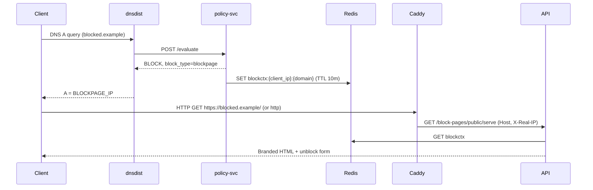
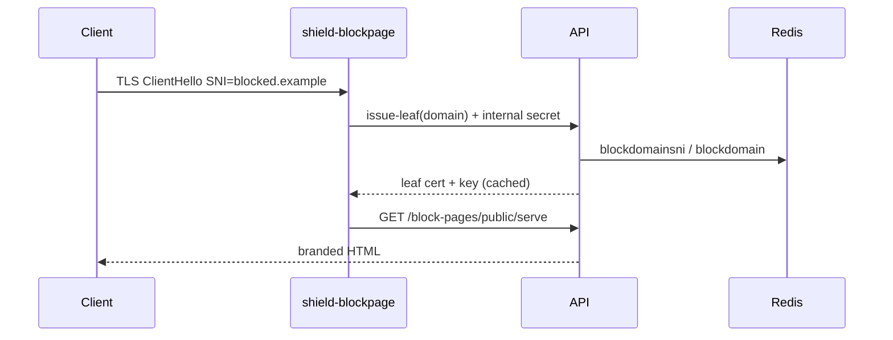

# Flux Shield — Custom Block Pages & Unblock Requests

**Product:** Flux Shield (Nebula DNS)  
**Status:** Phase 1 design + implementation  
**Branding:** Flux palette navy `#1E3B78`, blue `#4B7CBB`, coral `#FF6E62`; platform default includes a single **Powered by Flux Labs** footer line.

## 1. Inventory — What Exists Today

### DNS data plane (`deploy/droplet/`)

| Component | Behavior today |
|-----------|----------------|
| **policy-svc** | Evaluates queries; returns `decision`, `reason`, `category`, `block_type` (`NXDOMAIN`, `null`, or `blockpage`). |
| **dnsdist** | On `BLOCK`, if `block_type == "blockpage"`, spoofs A record to `BLOCKPAGE_IP` (env, default `127.0.0.1`); `null` → `0.0.0.0`; else **NXDOMAIN**. |
| **Compiled policy (API → Redis)** | Historically hard-coded `blockResponseType: 'NXDOMAIN'` in `policy-compiler.service.ts` — block pages were not enabled end-to-end. |
| **Tenant setting** | `tenants.settings.blockPageEnabled` exists on the tenant model but was not wired into compilation. |
| **Caddy** | Terminates TLS for API and DoH; **no** catch-all HTTP vhost for sinkholed browser traffic yet. |

### Control plane — Block pages module (`api/src/modules/block-pages/`)

- PostgreSQL tables: `block_pages`, `access_requests` (also in `scripts/init-postgres.sql`).
- CRUD for tenant block page templates, HTML generator with XSS/CSS sanitization, preview endpoint.
- Public `render/:tenantSlug` and `access-requests/public` were **stubs** (mock page, `demo-tenant-id`).
- Review workflow updates request status but did **not** add allow-list entries or audit logs.
- Locations support `block_page_id` in DB migrations; TypeORM entity lagged behind.

### UI (`ui/`)

- `/dashboard/block-pages` — editor modal with live preview, access-request inbox (approve/deny).
- Tier gate: `block-pages` feature.
- Branding still referenced legacy “Nebula DNS” defaults in places.

### Admin UI (`admin-ui/`)

- No platform default block page editor (Phase 1 adds one).

### Windows agent (`agents/safedns-agent`)

- Can install the **Flux Shield CA** into `LocalMachine\Root` when `install_shield_ca` and tenant `installShieldCaOnAgent` are enabled (alongside Intune/GPO/RMM).
- Agent CA install is **not** a substitute for MDM on non-Windows devices; all endpoints that should see HTTPS block pages need the CA in the OS trust store (or Firefox enterprise roots — see §2).

---

## 2. Sinkhole Architecture

### Flow

### Per-tenant identification

When a query is **BLOCK**ed with `blockpage`, **policy-svc** writes:

`blockctx:{normalized_client_ip}:{normalized_domain}` → JSON `{ tenantId, locationId, category, reason, blockPageId? }` (TTL **600s**).

The block page server resolves context using:

1. `Host` header (blocked domain, strip trailing dot).
2. Client IP from `X-Real-IP` / `X-Forwarded-For` (first hop) matching the DNS client.

Fallback (preview / misconfigured sinkhole): query params `tenantSlug`, `domain`, `category` for authenticated preview only.

Optional future: dnsdist EDNS0 option or encoded CNAME target — not required for Phase 1.

### HTTPS block pages — Flux Shield CA (required)

Browsers hitting `https://blocked-site.com/` expect a certificate for **that** hostname. A shared sinkhole IP cannot use publicly trusted certs for arbitrary blocked domains. **HTTPS block pages are required for the product story** and are delivered by:

1. **Offline Flux Shield root** (platform ops; never on droplets).
2. **Per-MSP (or per-tenant) intermediate CA** stored encrypted in PostgreSQL; issued from the root at provision time.
3. **Dynamic leaf certificates** minted only for hostnames that are **currently blocked** (Redis proof: `blockdomainsni:{domain}` / `blockdomain:{tenantId}:{domain}` from policy-svc).
4. **HTTPS terminator** (`shield-blockpage`) on the sinkhole: SNI → `POST /shield-ca/internal/issue-leaf` → present leaf → reverse-proxy HTML from `/block-pages/public/serve`.
5. **Organization trust:** MSP deploys the Shield **intermediate as a trusted root** on every endpoint that should see HTTPS block pages (Intune, GPO, Jamf, `.mobileconfig`, RMM, or Windows agent).

HTTP `:80` catch-all (Caddy → API) remains for lab verification and for clients that still attempt plain HTTP; it is **not** the primary UX for modern sites.

#### Endpoint trust — what works vs what still breaks

| Scenario | HTTPS block page |
|----------|------------------|
| **Shield CA trusted** (Chrome, Edge, Safari on managed devices) | Works, including sites that send **HSTS** or are on the **HSTS preload list** — major browsers treat **locally installed enterprise roots** as valid for HSTS-protected hosts when that root signed the connection. |
| **Device without Shield CA** | TLS fails or shows untrusted cert; user may not reach the block page on HTTPS-first navigations. |
| **Firefox (default profile)** | Does not use the Windows/macOS system store by default; requires **enterprise roots** (`security.enterprise_roots.enabled` on Windows) and/or **Firefox ESR policies** / imported CA in Firefox’s own store. |
| **Certificate pinning** (mobile apps, some browsers/extensions, pinned TLS stacks) | **Still breaks** — pinning rejects any non-public CA, including Shield CA, regardless of OS trust. |

**Operational summary:** Deploy the CA broadly; document pinning and Firefox exceptions for security/compliance reviewers. Do not claim HSTS preload blocks Shield — it does **not**, once the CA is trusted as above.

#### PKI security (MSP / platform)

- Root key offline; intermediate key encrypted at rest (`SHIELD_CA_MASTER_KEY`); leaf private keys ephemeral in terminator memory (short cache TTL).
- Issue leaves **only** for blocked domains with live Redis proof; internal APIs gated by `X-Shield-Internal-Secret`.
- Rotation: UI metadata `rotationRecommended` before intermediate expiry; redeploy trust via MDM/RMM/agent; plan intermediate re-issue from offline root.
- Revocation: stop issuing for unblocked domains immediately; remove org-wide trust on decommission; optional CRL/OCSP later.
- Flux Labs platform never holds customer domain TLS keys for public CAs — only Shield PKI material scoped to block-page sinkhole.

#### Per-tenant fallback

- `blockPageEnabled: false` → **NXDOMAIN** (or compiled `null` route) — no sinkhole, no leaf issuance.
- Compliance mode that forbids private CA → disable block pages or use NXDOMAIN-only (no branded HTTPS page).

---

## 3. Branding hierarchy

Resolution order for rendered page:

1. Location-specific `block_page_id` (when set).
2. Tenant default block page (`is_default`, `scope=tenant`).
3. MSP default (`is_default`, `scope=msp` on MSP tenant) for clients with `managed_by_msp_id`.
4. Platform default (`scope=platform`, single row).

Fields: logo, primary/secondary/accent colors, headline (`title`), message (markdown subset, sanitized), contact email/URL, toggles (show domain, category, reason, timestamp, unblock form), language (stored; UI Phase 1 en-US), `showPoweredBy` (true **only** on platform default).

MSP branding overrides apply when tenant fields are empty (logo, colors, support contacts).

---

## 4. Unblock request form

### End-user fields

- Requested URL/domain (prefilled, read-only).
- Name, email, reason (required email + reason for Phase 1).
- Honeypot field `companyWebsite` (must be empty).

### Anti-abuse

- Rate limit: **10 submissions / hour / IP** and **50 / hour / tenant** (Redis; degrades open if Redis unavailable — log warning).
- Optional Cloudflare Turnstile when `TURNSTILE_SECRET_KEY` is set.
- Honeypot rejection returns generic success (no leak).

### Operator workflow

- Inbox: tenant admins; MSP users can review for managed clients (same tenant scope rules).
- **Approve:** optional allow-list entry on tenant allow list `"Unblock requests"` (auto-created), optional expiry via entry comment/metadata; recompile policies for tenant locations.
- **Deny:** optional note stored on request.
- Notifications: email via SendGrid when configured (`EmailService`); in-app hooks reserved; mobile push interface stub (`NotificationPort`) for future `cursor/mobile-phase0-api-prep-0a9a`.
- End-user email on decision when email provided.

### Privacy & retention

- Store **registrable domain** only from DNS context; if user types a path in “reason”, do not parse/store URL paths separately.
- Retain access requests **90 days** (configurable `ACCESS_REQUEST_RETENTION_DAYS`); audit logs follow existing audit policy.

---

## 5. Audit logging

Actions logged via `AuditLogsService`:

- `block_page` create/update/delete/platform update.
- `access_request` submit (metadata only, no PII in resource name).
- `access_request` approve/deny with allow-list side effects.

---

## 6. Phase 1 deliverables (this PR)

- API: inheritance, public serve/submit, logo upload, review → allow list, audit, migration + `init-postgres.sql` parity.
- API: **shield-ca** module (intermediate provisioning, leaf issuance, downloads, internal ask/issue).
- policy-svc: block context on sinkhole blocks; **block domain SNI keys** for leaf issuance.
- policy compiler: `blockpage` when `tenants.settings.blockPageEnabled`.
- Droplet: Caddy `:80` catch-all → API serve path; `BLOCKPAGE_IP` documented; **shield-blockpage** HTTPS terminator (see `DROPLET-DEPLOY.md`).
- UI: Flux Shield defaults in editor; inbox approve scope/expiry; **Shield Certificate** install page.
- Admin UI: platform default editor.
- Agent (optional automation): Windows Shield CA install when tenant setting enabled.
- Tests: inheritance, XSS, rate limit, tenant isolation, approve → allow list, shield-ca issuance guards.
- Screenshots under `docs/modules/block-pages/screenshots/`.

---

## 7. Open decisions for Jeremy (recommended defaults)

| Decision | Options | **Recommended default** |
|----------|---------|-------------------------|
| HTTPS block page | Shield CA + terminator vs NXDOMAIN-only | **Shield CA required** on endpoints; HTTP :80 for lab/fallback only |
| Block mode when feature disabled | NXDOMAIN vs null route | **NXDOMAIN** |
| Approve scope | Tenant-wide allow vs policy-only | **Tenant allow list** entry; policy-scoped in Phase 2 |
| Turnstile | Off vs on in prod | **Off** unless `TURNSTILE_SECRET_KEY` set |
| Powered by line | Always vs platform-only | **Platform default only** |
| Retention | 30 / 90 / 365 days | **90 days** |

See `docs/modules/block-pages/DROPLET-DEPLOY.md` for production droplet steps (not applied automatically).
