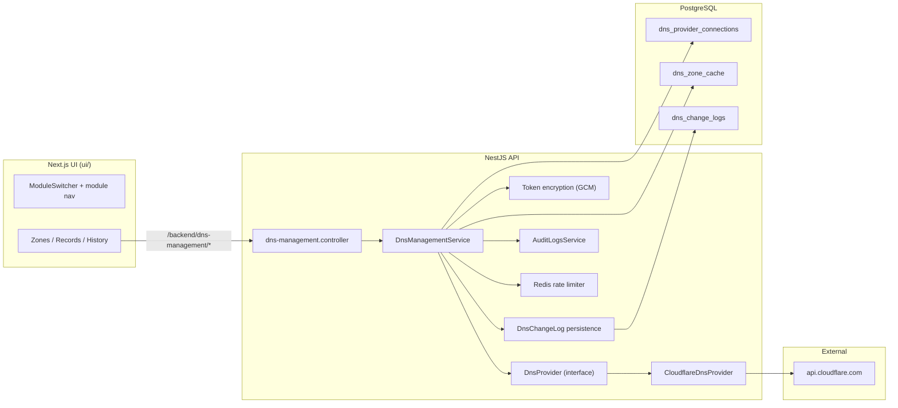

# DNS Management Module — Design

**Product:** [Flux Shield](https://shield.fluxlabs.net) by Flux Labs  
**Module:** DNS Management (platform module alongside DNS Filter and planned DMARC)  
**Status:** Design only — no product code in this document  
**Last updated:** 2026-10-31  

---

## Summary (non-specialist)

Flux Shield customers will connect **their own Cloudflare account** with a limited API token. From Flux Shield they can see their DNS zones and records, make safe edits (with confirmation on deletes), and review a tamper-evident history of every change—including **undo** from that history. MSP partners can do the same on behalf of a client tenant, with everything attributed in audit logs. We do **not** host customer zones under Flux Labs’ Cloudflare account in v1.

Technical work lives in a new NestJS module (`api/src/modules/dns-management/`), new Next.js routes under the UI app, and new constants in `shared/product-brand.ts` (synced via `./scripts/sync-product-brand.sh` to `ui/`, `admin-ui/`, and `www/`).

---

## Goals

| Goal | Detail |
|------|--------|
| **Bring-your-own Cloudflare** | Per-tenant API token with `Zone:Read` + `DNS:Edit`, scoped to selected zone(s). |
| **Full CRUD on supported record types** | A, AAAA, CNAME, MX, TXT, SRV, CAA, NS. |
| **Proxy toggle** | Cloudflare orange-cloud on/off where applicable. |
| **Auditability** | Who, what, before/after JSON, when—for every mutation and undo. |
| **Undo** | Any logged change can be reversed from the change history UI/API. |
| **Safety & tenancy** | Encrypted tokens, verify-on-connect, RBAC, delete confirmation, rate limits, strict tenant isolation. |
| **MSP delegation** | Reuse existing MSP context switch; actions audited under the client tenant with actor metadata. |

## Non-goals (v1)

- Hosting client zones on Flux Labs’ Cloudflare account.
- DNS templates (Microsoft 365, Google Workspace, etc.).
- BIND import/export.
- Publishing DMARC/SPF/DKIM from the DMARC module.
- Drift detection / scheduled zone snapshots.
- Non-Cloudflare providers (design hooks only).

---

## User stories

### MSP admin (partner tier)

1. **Connect on behalf of client:** After [MSP context switch](api/src/modules/msp/msp.service.ts) (`msp_context_switch` audit action), open DNS Management for the client tenant, paste a Cloudflare API token, verify it, and see only zones the token can access.
2. **Operate safely:** Edit records for a client; every action appears in change history with the MSP user’s identity and `metadata.mspUserId` / `metadata.mspTenantId` in audit payloads.
3. **Recover mistakes:** Undo a bad MX change from history without opening the Cloudflare dashboard.

### Client tenant admin (`owner` / `admin`)

1. **Connect Cloudflare:** Settings → DNS Management → Connect account; token verified via Cloudflare `/user/tokens/verify`; UI lists granted zones.
2. **Manage records:** Pick a zone, inline-edit records, toggle proxy, add records.
3. **Delete with guardrails:** Delete requires typing the record name (or FQDN) to confirm.
4. **Review history:** Filter change log by zone, user, action; undo when permitted.

### Read-only (`readonly`, and `analyst` for mutations)

1. **View zones and records** without connect/disconnect or write APIs.
2. **Export-friendly read:** Paginated record list suitable for support tickets (no token or secret fields in responses).

**RBAC mapping (v1):**

| Capability | Roles |
|------------|--------|
| Connect / disconnect / re-verify token | `owner`, `admin` |
| Create / update / delete / undo | `owner`, `admin` |
| List zones, records, change history | `owner`, `admin`, `analyst`, `readonly` |

Pattern reference: `@Roles` + `RolesGuard` on controllers ([`api/src/common/guards/roles.guard.ts`](api/src/common/guards/roles.guard.ts)), same as [`api/src/modules/lists/lists.controller.ts`](api/src/modules/lists/lists.controller.ts).

---

## Architecture

### High-level components



### Provider abstraction

Introduce an internal interface (Go-style naming in NestJS services folder):

```typescript
// api/src/modules/dns-management/providers/dns-provider.interface.ts (planned)

export type DnsProviderId = 'cloudflare' | 'route53' | 'dnsimple'; // v1: cloudflare only

export interface DnsProviderZone { id: string; name: string; status: string; paused: boolean; }
export interface DnsProviderRecord { id: string; type: string; name: string; content: string; ttl: number; proxied?: boolean; priority?: number; /* ... */ }

export interface DnsProvider {
  verifyToken(): Promise<{ status: 'active' | 'invalid'; zones: DnsProviderZone[] }>;
  listZones(): Promise<DnsProviderZone[]>;
  listRecords(zoneId: string, query?: { type?: string; name?: string }): Promise<DnsProviderRecord[]>;
  createRecord(zoneId: string, input: CreateRecordInput): Promise<DnsProviderRecord>;
  updateRecord(zoneId: string, recordId: string, input: UpdateRecordInput): Promise<DnsProviderRecord>;
  deleteRecord(zoneId: string, recordId: string): Promise<void>;
}
```

**v1 implementation:** `CloudflareDnsProvider` using fixed base URL `https://api.cloudflare.com/client/v4` (no user-supplied URLs — SSRF mitigation).

**Later providers:** Register in a small factory keyed by `DnsProviderConnection.provider`; share change-log schema with `provider` + opaque `provider_zone_id` / `provider_record_id`.

### Sync vs live-read strategy

| Data | Strategy | Rationale |
|------|----------|-----------|
| **Zone directory** | **Cached in Postgres** (`dns_zone_cache`) + **refresh** on connect, manual “Sync zones”, and lazy refresh if cache age &gt; TTL (default 15 minutes) | Zone list changes infrequently; reduces Cloudflare `GET /zones` calls. |
| **DNS records** | **Live read** from Cloudflare on each list/detail request (optional short Redis cache **per zone**, TTL 30–60s, invalidated on any mutation for that zone) | Records must reflect reality for edits; stale cache caused support incidents in similar products. |
| **Mutations** | **Write-through** to Cloudflare, then append **change log** row with before/after snapshots | Undo replays inverse operation using stored JSON, not cache. |

On connect/re-verify, upsert `dns_zone_cache` rows and prune zones no longer in the token scope (soft-delete or `visible: false` flag—prefer soft-delete for audit continuity).

### Module registration

- Register `DnsManagementModule` in [`api/src/app.module.ts`](api/src/app.module.ts) alongside `SiemModule`, `WebhooksModule`, etc.
- TypeORM entities registered in the same module pattern as [`api/src/modules/siem/siem.module.ts`](api/src/modules/siem/siem.module.ts).
- UI: new app segment e.g. `ui/src/app/dns-management/` with layout reusing [`ui/src/components/layout/DashboardLayout.tsx`](ui/src/components/layout/DashboardLayout.tsx) patterns and a **module-local** nav config (mirror [`ui/src/components/layout/NavigationConfig.ts`](ui/src/components/layout/NavigationConfig.ts)).
- Extend [`ui/src/components/layout/ModuleSwitcher.tsx`](ui/src/components/layout/ModuleSwitcher.tsx) and [`shared/product-brand.ts`](shared/product-brand.ts) with `PRODUCT_MODULE_DNS_MANAGEMENT = 'DNS Management'`.

### Branding

Use existing Flux palette via [`shared/flux-labs-tailwind-theme.js`](shared/flux-labs-tailwind-theme.js) (`primary` navy `#1E3B78`, `#4B7CBB`, accent coral `#FF6E62`). Chart colors already documented in [`ui/src/lib/chart-colors.ts`](ui/src/lib/chart-colors.ts). Prefer `primary-*` and `accent-*` Tailwind tokens over hard-coded hex in components.

---

## Data model (TypeORM / PostgreSQL)

All tables include `tenant_id` (UUID) and follow [`TenantScopedEntity`](api/src/common/entities/base.entity.ts) / explicit `tenant_id` columns like other modules.

### `dns_provider_connections`

| Column | Type | Notes |
|--------|------|--------|
| `id` | UUID PK | |
| `tenant_id` | UUID | FK → `tenants`; unique partial index: one **active** Cloudflare connection per tenant in v1 |
| `provider` | varchar | `'cloudflare'` |
| `label` | varchar | User-facing name, e.g. “Production CF” |
| `token_ciphertext` | text | AES-256-GCM via [`encrypt()`](api/src/common/utils/encryption.util.ts) |
| `token_key_id` | varchar | Future key rotation; v1 constant `v1` |
| `token_fingerprint` | varchar | SHA-256 prefix of token for “same token re-connect” detection **without** storing plaintext |
| `status` | enum | `pending`, `active`, `invalid`, `revoked` |
| `verified_at` | timestamptz | Last successful verify |
| `last_error_code` | varchar nullable | Cloudflare error code |
| `last_error_message` | text nullable | Sanitized message for UI |
| `allowed_zone_ids` | jsonb | Zone IDs returned at verify (CF zone id strings) |
| `created_by_user_id` | UUID | |
| `updated_at` | timestamptz | |

**Encryption:** New env key `DNS_MANAGEMENT_ENCRYPTION_KEY` added to [`ENCRYPTION_KEYS`](api/src/config/encryption.config.ts) (same validation path as `SIEM_ENCRYPTION_KEY`). Derive with `deriveKey(key, 'dns-management-gcm-salt')` mirroring [`SiemService`](api/src/modules/siem/siem.service.ts).

**Never** return `token_ciphertext` or decrypted token in API responses.

### `dns_zone_cache`

| Column | Type | Notes |
|--------|------|--------|
| `id` | UUID PK | |
| `tenant_id` | UUID | |
| `connection_id` | UUID FK | |
| `provider_zone_id` | varchar | Cloudflare zone id |
| `name` | varchar | e.g. `example.com` |
| `status` | varchar | active, pending, etc. |
| `paused` | boolean | |
| `synced_at` | timestamptz | |
| `removed_at` | timestamptz nullable | When zone dropped from token scope |

Unique: `(tenant_id, connection_id, provider_zone_id)`.

### `dns_change_logs`

Dedicated table for **undo** and rich DNS diffs (platform [`audit_logs`](api/src/modules/audit-logs/entities/audit-log.entity.ts) stays the cross-module security trail).

| Column | Type | Notes |
|--------|------|--------|
| `id` | UUID PK | |
| `tenant_id` | UUID | |
| `connection_id` | UUID | |
| `provider_zone_id` | varchar | |
| `zone_name` | varchar | Denormalized for UI |
| `provider_record_id` | varchar nullable | Null for failed creates |
| `record_name` | varchar | |
| `record_type` | varchar | |
| `action` | enum | `create`, `update`, `delete`, `proxy_toggle`, `undo` |
| `before_json` | jsonb nullable | Full provider record snapshot |
| `after_json` | jsonb nullable | |
| `performed_by_user_id` | UUID | |
| `ip_address` | inet nullable | |
| `user_agent` | text nullable | |
| `metadata` | jsonb | `mspUserId`, `mspTenantId`, `cloudflareRequestId`, `idempotencyKey` |
| `reverts_change_id` | UUID nullable FK → self | Set when this row **is** an undo |
| `undone_at` | timestamptz nullable | Set on original row when superseded |
| `undone_by_change_id` | UUID nullable FK → self | |
| `created_at` | timestamptz | |

**Undo rules:**

- Only the latest non-undone change for a given `provider_record_id` (or name+type for creates) may be undone, **or** allow undo of any row that is still consistent with live state (v1: **strict stack** — undo only if no newer change exists for same record id).
- Undo executes inverse API call, writes new `dns_change_logs` row with `action: undo` and `reverts_change_id` pointing to original.

**Platform audit:** On each mutation/undo, call [`AuditLogsService.log()`](api/src/modules/audit-logs/audit-logs.service.ts) with extended types (migration to enums):

- `AuditAction`: add `dns_record_create`, `dns_record_update`, `dns_record_delete`, `dns_connection_create`, `dns_connection_delete`, `dns_change_undo`
- `AuditResourceType`: add `dns_connection`, `dns_zone`, `dns_record`

Store summary in `resourceName`; full diff remains in `dns_change_logs` (and optional `oldValue`/`newValue` on audit row for Settings → Audit tab parity).

---

## API endpoints

**Base path:** `@Controller('dns-management')` → `/dns-management/...` on the API service (same convention as `/lists`, `/policies`). Client calls via UI proxy [`ui/src/app/backend/[...path]/route.ts`](ui/src/app/backend/[...path]/route.ts) as `/backend/dns-management/...`.

**Auth:** JWT + `RolesGuard`. **Tenant:** `@CurrentTenant()` from [`tenant.decorator.ts`](api/src/common/decorators/tenant.decorator.ts) (respects MSP-switched tenant on JWT).

**Pagination:** [`PaginationQueryDto`](api/src/common/dto/pagination.dto.ts) / `PaginatedResponse<T>` for list endpoints.

### Connections

| Method | Path | Roles | Description |
|--------|------|-------|-------------|
| `GET` | `/dns-management/connections` | all read roles | List connections (no secrets) |
| `POST` | `/dns-management/connections` | owner, admin | Body: `{ label, token }` → verify, encrypt, store, sync zones |
| `POST` | `/dns-management/connections/:id/verify` | owner, admin | Re-verify token; refresh `allowed_zone_ids` + zone cache |
| `DELETE` | `/dns-management/connections/:id` | owner, admin | Revoke connection (mark revoked; wipe ciphertext optional after retention policy) |

**POST `/connections` response (201):**

```json
{
  "data": {
    "id": "uuid",
    "provider": "cloudflare",
    "label": "Main account",
    "status": "active",
    "verifiedAt": "2026-10-31T12:00:00Z",
    "zones": [{ "id": "cf-zone-id", "name": "example.com", "status": "active" }]
  }
}
```

**GET `/connections` item shape:** omit token; include `status`, `verifiedAt`, `lastError`, zone count.

### Zones

| Method | Path | Roles | Description |
|--------|------|-------|-------------|
| `GET` | `/dns-management/zones` | read | From cache; query `?refresh=true` forces CF sync |
| `POST` | `/dns-management/zones/sync` | owner, admin | Force refresh zone cache |

### Records (live Cloudflare)

| Method | Path | Roles | Description |
|--------|------|-------|-------------|
| `GET` | `/dns-management/zones/:zoneId/records` | read | Query: `type`, `name`, `cursor`, `limit` |
| `POST` | `/dns-management/zones/:zoneId/records` | owner, admin | Create |
| `PATCH` | `/dns-management/zones/:zoneId/records/:recordId` | owner, admin | Update content, TTL, priority, proxied |
| `DELETE` | `/dns-management/zones/:zoneId/records/:recordId` | owner, admin | Requires body `{ "confirmName": "www.example.com" }` |

**Record DTO (request/response):**

```json
{
  "type": "A",
  "name": "www",
  "content": "192.0.2.1",
  "ttl": 300,
  "proxied": true,
  "priority": null,
  "comment": "optional CF comment field if supported"
}
```

Validate types against allowlist; MX/SRV require priority/port fields per Cloudflare schema.

### Change history & undo

| Method | Path | Roles | Description |
|--------|------|-------|-------------|
| `GET` | `/dns-management/changes` | read | Filters: `zoneId`, `recordId`, `userId`, `from`, `to` |
| `GET` | `/dns-management/changes/:id` | read | Single entry with before/after |
| `POST` | `/dns-management/changes/:id/undo` | owner, admin | Performs inverse op + logs |

**Undo response (200):**

```json
{
  "data": {
    "undoChangeId": "uuid",
    "revertedChangeId": "uuid",
    "record": { /* current live record */ }
  }
}
```

### Error shape

Use global [`GlobalExceptionFilter`](api/src/main.ts) format. Map Cloudflare 4xx to 502/400 with `details.cloudflareErrors[]` without leaking token.

---

## UI screens

All pages use existing UI primitives (cards, tables, modals) consistent with Policies/Lists pages; module accent via `primary`/`accent` tokens.

### Platform navigation

1. **Module switcher** ([`ModuleSwitcher.tsx`](ui/src/components/layout/ModuleSwitcher.tsx)): add **DNS Management** between DNS Filter and DMARC; `href: '/dns-management'`, `available: true` when feature flag / tier enables module.
2. **Module sidebar** (new `DnsManagementNavigationConfig.ts`): Overview (zones), Change history, Settings (connection).

### Screen: Connect account (`/dns-management/settings/connection`)

- Empty state explaining BYO Cloudflare token scopes.
- Token field (password input, never prefilled); link to Cloudflare doc for creating scoped tokens.
- On submit: loading → success shows verified zones checklist; error shows CF message (token invalid / insufficient scope).
- Connected state: connection label, last verified, “Re-verify”, “Disconnect” (confirm modal).

### Screen: Zone list (`/dns-management`)

- Table: zone name, status, record count (optional CF `GET /zones/:id/dns_records` count with caching), last synced.
- “Sync zones” button (admin+).
- Row click → records.

### Screen: Record table (`/dns-management/zones/[zoneId]`)

- Filter by type/name; columns: name, type, content, TTL, proxy (toggle for admin+), actions.
- Inline edit row or slide-over drawer (match Lists UX patterns).
- Add record modal with type-specific fields.
- Delete opens modal requiring **typed confirmation** matching `record.name` FQDN.

### Screen: Change history (`/dns-management/history`)

- Timeline/table: time, user, zone, record, action, diff summary (expand for JSON).
- **Undo** button on eligible rows (admin+); confirm modal explaining inverse action.
- Cross-link from record row “View history”.

Optional: surface recent DNS changes in Settings → Audit ([`ui/src/app/dashboard/settings/security/page.tsx`](ui/src/app/dashboard/settings/security/page.tsx)) via new audit action filters.

---

## Security & threat model

| Threat | Mitigation |
|--------|------------|
| **Token leakage at rest** | AES-256-GCM encryption; key from `DNS_MANAGEMENT_ENCRYPTION_KEY`; no token in logs/responses; fingerprint only for dedup. |
| **Token leakage in transit** | HTTPS only; token submitted once in POST body; UI never stores in localStorage. |
| **Cross-tenant access** | Every query filters by `tenant_id` from JWT; connection IDs validated `(id, tenant_id)` before use; zoneId must be in `allowed_zone_ids` / cache for tenant. |
| **Privilege escalation** | `RolesGuard`; readonly cannot mutate; MSP actions only when JWT tenant is switched client ([`MspService`](api/src/modules/msp/msp.service.ts)). |
| **Destructive DNS changes** | Typed delete confirmation; audit + change log; undo. |
| **SSRF** | Hard-coded Cloudflare API host; no user-controlled outbound URLs (contrast with locked-down patterns in webhook delivery). |
| **Rate abuse / CF suspension** | Per-tenant + per-connection Redis limits ([`rate-limit` module](api/src/modules/rate-limit/rate-limit.module.ts)); exponential backoff on CF 429; global cap below CF documented limits (e.g. 900 req / 5 min per connection with jitter). |
| **Audit tampering** | DNS change log append-only; platform audit hash chain unchanged ([`AuditLog.recordHash`](api/src/modules/audit-logs/entities/audit-log.entity.ts)). |
| **Undo race** | DB transaction: lock change row, verify live record still matches `after_json` (or delete still absent), then apply inverse. |

---

## Error handling

| Scenario | Behavior |
|----------|----------|
| **Invalid / revoked token** | Mark connection `invalid`; read endpoints return 409 with `connectionStatus`; UI prompts re-connect. |
| **Zone removed from token scope** | Hide from list or show “disconnected scope”; mutations 403. |
| **Cloudflare validation error** | 400 with field-level messages (duplicate record, invalid CNAME, etc.). |
| **CF 5xx / timeout** | 502 with retry guidance; no change log row on failed mutation. |
| **Partial batch (future)** | N/A v1 (no bulk). |
| **Undo impossible** | 409 if record changed since; show diff in error `details`. |

Structured logging via Nest `Logger`; include `tenantId`, `connectionId`, `zoneId`, `changeId` — never token.

---

## Observability

| Signal | Implementation |
|--------|----------------|
| **Metrics** | Extend [`MetricsService`](api/src/modules/metrics/metrics.service.ts): counters `dns_management_cf_requests_total{operation,status}`, `dns_management_mutations_total{action}`, histogram `dns_management_cf_latency_seconds`. |
| **Tracing** | Optional OpenTelemetry spans around CF HTTP client (follow existing Sentry module in [`api/src/common/sentry`](api/src/common/sentry/sentry.module.ts)). |
| **Logs** | Info on connect/verify; warn on CF 429; error on verify failure. |
| **Dashboards** | Grafana panel: CF error rate, undo count, connections in `invalid` state. |

---

## Testing strategy

| Layer | Approach |
|-------|----------|
| **Unit** | Mock `DnsProvider`; test undo logic, confirmation validator, tenant guards. |
| **Integration** | Nest e2e with test DB; mock CF with `nock` or MSW on fixed base URL. |
| **Contract** | Golden files for CF JSON responses (list zones, list records, create, update, delete, verify token). |
| **UI** | Playwright: connect flow (mock API), edit record, delete confirmation, undo. |

Follow patterns in [`api/src/modules/lists/lists.controller.spec.ts`](api/src/modules/lists/lists.controller.spec.ts) and [`api/src/modules/rate-limit/rate-limit.integration.spec.ts`](api/src/modules/rate-limit/rate-limit.integration.spec.ts).

---

## Future hooks (not v1)

Document in code via interface stubs and nullable columns only—no UI.

- **`provider` enum** on connections for Route 53 / DNSimple.
- **`dns_record_templates` table** + apply template job queue.
- **`dns_zone_snapshots`** for drift detection (compare live vs last snapshot).
- **Event bus:** emit `dns.record.changed` for DMARC module to offer “Publish SPF/DMARC” (webhook channel pattern from [`WebhooksService`](api/src/modules/webhooks/webhooks.service.ts)).
- **Tier feature flag** in [`ui/src/lib/tier-features.ts`](ui/src/lib/tier-features.ts): `dns-management`.

---

## Request flow (reference diagram)

See [FLOW.md](./FLOW.md) for the canonical request-flow diagram (connect, read, mutate, undo).
