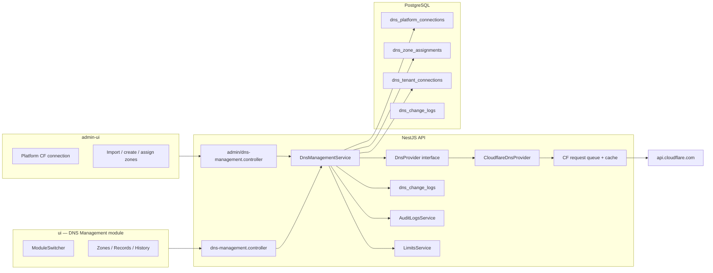

# DNS Management Module — Design

**Product:** [Flux Shield](https://shield.fluxlabs.net) by Flux Labs  
**Module:** DNS Management (platform module alongside DNS Filter and planned DMARC)  
**Status:** Design only — no product code in this document  
**Last updated:** 2026-10-31 (rev 2 — MSP-hosted zones primary)

---

## Summary (non-specialist)

Most client domains will live in **Flux Labs’ Cloudflare account**. Platform admins configure one secured Cloudflare connection in the **Admin Console** ([`admin-ui/`](../../../admin-ui/)), import or create zones there, and **assign zones to customer tenants**. Tenant users only see their assigned zones and edit DNS records according to per-zone permissions—they never see the platform token.

Clients who keep their own Cloudflare account can still use an optional **bring-your-own (BYO) token** later; both paths share the same provider layer, change log, and undo behavior.

Technical work: NestJS `api/src/modules/dns-management/`, tenant UI routes in `ui/`, platform ops in `admin-ui/`, branding in [`shared/product-brand.ts`](../../../shared/product-brand.ts) (sync via `./scripts/sync-product-brand.sh`).

---

## Goals

| Goal | Detail |
|------|--------|
| **MSP-hosted zones (primary)** | Single platform Cloudflare token; zones in Flux account assigned to tenants. |
| **Zone lifecycle (platform admin)** | Import/link existing zones, create new zones, show assigned nameservers, assign/unassign tenant. |
| **Tenant DNS ops** | View/edit records on assigned zones only; server resolves zones by internal ID (never trust client-supplied Cloudflare zone IDs). |
| **Granular tenant permissions** | Per-assignment flags: edit records, allow proxy toggle, allow deletes (and undo where edits allowed). |
| **Full CRUD on supported types** | A, AAAA, CNAME, MX, TXT, SRV, CAA, NS. |
| **Audit + undo** | Who, what, before/after JSON, when; undo from change history. |
| **BYO Cloudflare (secondary)** | Per-tenant token option for clients outside Flux-hosted zones (later phase). |
| **Fair shared API budget** | All platform-hosted tenants share one Cloudflare account limit (~1200 req / 5 min)—queue + cache fairly. |
| **Billing hook** | Enforce **zone count per tenant** via existing limits infrastructure. |

## Non-goals (v1)

- **Account-level Cloudflare settings** for tenants (SSL mode, zone settings, page rules, etc.) — **MSP / platform admin only** in v1; tenants get DNS records only.
- DNS templates (Microsoft 365, Google Workspace).
- BIND import/export.
- DMARC module one-click publish.
- Drift detection / scheduled snapshots.
- Non-Cloudflare providers (interface hooks only).

---

## Provisioning models

| Model | Who connects CF | Token storage | Zone discovery |
|--------|-----------------|---------------|----------------|
| **`platform_hosted`** (default) | Platform admin in admin-ui | One (or few purpose-scoped) platform token(s); encrypted server-side | Admin imports/creates zones in Flux account; assigns `tenant_id` |
| **`byo_token`** (optional) | Tenant `owner`/`admin` in ui | Per-tenant encrypted token | Token verify → zones intersect tenant assignment or full token scope |

Every zone row stores `provisioning_model` + `connection_id` (platform or tenant connection). `CloudflareDnsProvider` receives credentials from the resolved connection only inside the service layer.

---

## User stories

### Platform admin ([`admin-ui`](../../../admin-ui/) + `AdminAuthGuard`)

1. **Configure platform connection:** Settings → DNS Platform → paste scoped Cloudflare API token (`Zone:Read`, `Zone:Edit`, `Zone:Create` as needed for import/create); verify via `/user/tokens/verify`; token encrypted like [`SiemService`](../../../api/src/modules/siem/siem.service.ts).
2. **Import zones:** List unassigned zones in Flux account; link to tenant or leave in pool.
3. **Create zone for tenant:** Create zone in CF for `customer.example`; display Cloudflare nameservers for cutover; auto-assign to selected tenant.
4. **Assign / unassign:** Map zone ↔ tenant; set permission flags; unassign does not delete CF zone.
5. **Emergency:** Revoke/rotate token via admin-ui; runbook in [`docs/runbooks/`](../../runbooks/) (see threat model).

Pattern: [`api/src/modules/admin/guards/admin-auth.guard.ts`](../../../api/src/modules/admin/guards/admin-auth.guard.ts), controllers under `@Controller('admin/...')` like [`admin-users.controller.ts`](../../../api/src/modules/admin/admin-users.controller.ts).

### MSP admin (partner tier, tenant UI)

1. After [MSP context switch](api/src/modules/msp/msp.service.ts), open DNS Management for client; see **only zones assigned to that tenant**.
2. Edit records if assignment permissions allow; audit shows MSP actor metadata.
3. Cannot access platform token or unassigned Flux zones.

### Client tenant admin (`owner` / `admin`)

1. Open DNS Management module; zone list = assignments only (empty state: “Contact your provider” if none).
2. Manage records within permission flags; typed delete confirmation when deletes allowed.
3. Review change history; undo when edits allowed.

### Read-only (`readonly`, `analyst` for mutations)

1. View assigned zones, records, and history; no mutations.

**RBAC (tenant API, v1):**

| Capability | Roles | Also requires |
|------------|--------|----------------|
| List zones / records / history | owner, admin, analyst, readonly | Zone assigned to tenant |
| Create / update records | owner, admin | Assignment `canEditRecords` |
| Proxy toggle | owner, admin | Assignment `canToggleProxy` |
| Delete / undo | owner, admin | Assignment `canDeleteRecords` / undo rules |

Platform admin routes use **admin roles**, not tenant `RolesGuard`.

---

## Architecture

### High-level components



### Provider abstraction

Same interface for both models; credential source is an implementation detail:

```typescript
// api/src/modules/dns-management/providers/dns-provider.interface.ts (planned)

export type DnsProvisioningModel = 'platform_hosted' | 'byo_token';

export interface DnsProviderCredentials {
  model: DnsProvisioningModel;
  connectionId: string; // platform or tenant connection row
}

export interface DnsProvider {
  verifyToken(): Promise<{ status: 'active' | 'invalid'; zones?: DnsProviderZone[] }>;
  listAccountZones(): Promise<DnsProviderZone[]>;
  createZone(input: { name: string; accountId?: string }): Promise<DnsProviderZone & { nameServers: string[] }>;
  listRecords(providerZoneId: string, query?: RecordListQuery): Promise<DnsProviderRecord[]>;
  createRecord(providerZoneId: string, input: CreateRecordInput): Promise<DnsProviderRecord>;
  updateRecord(providerZoneId: string, recordId: string, input: UpdateRecordInput): Promise<DnsProviderRecord>;
  deleteRecord(providerZoneId: string, recordId: string): Promise<void>;
}
```

Outbound HTTP: fixed host `https://api.cloudflare.com/client/v4` only (SSRF mitigation).

### Zone identity & tenant boundary

- **Public API identifiers:** `zoneId` in tenant routes is **`dns_zone_assignments.id`** (UUID), not Cloudflare’s zone id.
- **Resolution:** Service loads assignment where `id = :zoneId AND tenant_id = @CurrentTenant()`; reads `provider_zone_id` internally; rejects if unassigned or wrong tenant.
- **Client-supplied CF zone IDs:** Ignored if present; never used for authorization.

### Sync vs live-read strategy

| Data | Strategy | Rationale |
|------|----------|-----------|
| **Flux account zone inventory** | Postgres (`dns_zone_assignments` + metadata); refresh on admin import/sync | Avoid hammering `GET /zones` on every admin page load. |
| **Tenant zone list** | DB only (assignments for tenant) | No CF call to list tenant zones. |
| **DNS records** | Live read via CF through **shared queue**; optional Redis cache per `provider_zone_id` TTL 45–60s, invalidated on mutation | Accuracy for edits; cache reduces shared limit pressure. |
| **Mutations** | Write-through CF → append `dns_change_logs` | Undo uses stored JSON. |

### Shared Cloudflare rate limit & fair queue

Cloudflare account limit (~**1200 requests / 5 minutes**) is **shared by all tenants** on platform-hosted zones.

| Mechanism | Behavior |
|-----------|----------|
| **Global token bucket (Redis)** | Key `dns:cf:platform:ratelimit`; refill aligned to CF window; reserve ~10% headroom (e.g. cap at 1080/5min). |
| **Fair queue** | All CF calls enqueue in Redis (e.g. stream/list); workers dequeue with **weighted fair scheduling**—per-tenant in-flight cap + round-robin across tenants; admin ops use separate high-priority lane with small reserved budget. |
| **Coalescing** | Duplicate in-flight `GET dns_records` for same zone coalesced to one CF request. |
| **Backoff** | On CF 429: exponential backoff, pause tenant briefly, surface 503/`Retry-After` to UI. |
| **Tenant-facing limit** | Additional `@RateLimit()` on tenant API ([`rate-limit` module](api/src/modules/rate-limit/rate-limit.module.ts)) so one tenant cannot starve others before queue fairness kicks in. |

BYO connections use a **per-tenant** bucket (separate CF account) when implemented.

### Module registration

- `DnsManagementModule` in [`api/src/app.module.ts`](../../../api/src/app.module.ts).
- Admin routes in existing [`AdminModule`](../../../api/src/modules/admin/admin.module.ts) or sub-module imported there.
- Tenant UI: `ui/src/app/dns-management/` + [`ModuleSwitcher.tsx`](../../../ui/src/components/layout/ModuleSwitcher.tsx).
- Admin UI: e.g. `admin-ui/src/app/dns-platform/` (nav alongside MSPs per [`admin-ui/src/components/layout/Header.tsx`](../../../admin-ui/src/components/layout/Header.tsx)).

### Branding

[`shared/flux-labs-tailwind-theme.js`](../../../shared/flux-labs-tailwind-theme.js) — navy `#1E3B78`, blue `#4B7CBB`, coral `#FF6E62` ([`ui/src/lib/chart-colors.ts`](../../../ui/src/lib/chart-colors.ts)).

---

## Data model (TypeORM / PostgreSQL)

### `dns_platform_connections` (platform scope)

Not tenant-scoped. At most one **active** row per purpose in v1 (e.g. `primary`).

| Column | Type | Notes |
|--------|------|--------|
| `id` | UUID PK | |
| `label` | varchar | e.g. “Flux Labs production CF” |
| `provider` | varchar | `cloudflare` |
| `purpose` | varchar | `primary`, future: `readonly_replica` |
| `token_ciphertext` | text | AES-256-GCM ([`encrypt()`](../../../api/src/common/utils/encryption.util.ts)) |
| `token_key_id` | varchar | Rotation support |
| `token_fingerprint` | varchar | SHA-256 prefix; no plaintext |
| `status` | enum | `pending`, `active`, `invalid`, `revoked` |
| `verified_at` | timestamptz | |
| `last_rotated_at` | timestamptz | |
| `created_by_admin_id` | UUID | Admin user |
| `metadata` | jsonb | CF account id, granted scopes snapshot |

Encryption key: `DNS_MANAGEMENT_ENCRYPTION_KEY` in [`encryption.config.ts`](../../../api/src/config/encryption.config.ts); derive `dns-management-gcm-salt`.

### `dns_zone_assignments` (authoritative tenant ↔ zone mapping)

| Column | Type | Notes |
|--------|------|--------|
| `id` | UUID PK | **This** is `zoneId` in tenant APIs |
| `tenant_id` | UUID FK | Assigned tenant |
| `provisioning_model` | enum | `platform_hosted` \| `byo_token` |
| `connection_id` | UUID | FK → platform or tenant connection |
| `provider_zone_id` | varchar | Cloudflare zone id (internal) |
| `zone_name` | varchar | `example.com` |
| `status` | varchar | active, pending, moved |
| `name_servers` | jsonb | Last known NS set (for UI) |
| `can_edit_records` | boolean | default true |
| `can_toggle_proxy` | boolean | default true |
| `can_delete_records` | boolean | default true |
| `assigned_at` | timestamptz | |
| `assigned_by_admin_id` | UUID nullable | Platform admin or null for MSP-automated |
| `unassigned_at` | timestamptz nullable | Soft unassign |

Unique active: `(provider_zone_id, provisioning_model)` where `unassigned_at IS NULL` for platform_hosted.

**Billing:** Count rows where `tenant_id = ? AND unassigned_at IS NULL AND status = active` toward limit.

### `dns_tenant_connections` (BYO — later phase)

Same shape as prior design’s per-tenant connection: `tenant_id`, encrypted token, `allowed_zone_ids`, status. Used only for `byo_token` assignments.

### `dns_change_logs`

| Column | Type | Notes |
|--------|------|--------|
| `id` | UUID PK | |
| `tenant_id` | UUID | |
| `zone_assignment_id` | UUID FK | |
| `provisioning_model` | enum | |
| `connection_id` | UUID | |
| `provider_zone_id` | varchar | Internal audit |
| `zone_name` | varchar | |
| `provider_record_id` | varchar nullable | |
| `record_name`, `record_type` | varchar | |
| `action` | enum | `create`, `update`, `delete`, `proxy_toggle`, `undo` |
| `before_json`, `after_json` | jsonb | |
| `performed_by_user_id` | UUID | |
| `ip_address`, `user_agent` | | |
| `metadata` | jsonb | MSP ids, CF request id, `adminActorId` for platform actions |
| `reverts_change_id`, `undone_at`, `undone_by_change_id` | | Undo linkage |
| `created_at` | timestamptz | |

Platform audit via [`AuditLogsService`](../../../api/src/modules/audit-logs/audit-logs.service.ts) — extend enums:

- **Actions:** `dns_zone_assigned`, `dns_zone_unassigned`, `dns_zone_created`, `dns_platform_token_rotated`, `dns_record_*`, `dns_change_undo`, `dns_byo_connection_*`
- **Resource types:** `dns_platform_connection`, `dns_zone_assignment`, `dns_record`, `dns_tenant_connection`

---

## API endpoints

### Platform admin (`AdminAuthGuard` + admin roles)

Base: `@Controller('admin/dns-management')` — called from admin-ui backend proxy pattern (mirror tenant [`ui/src/app/backend/[...path]/route.ts`](../../../ui/src/app/backend/[...path]/route.ts)).

| Method | Path | Description |
|--------|------|-------------|
| `GET` | `/admin/dns-management/connection` | Status (no secret) |
| `POST` | `/admin/dns-management/connection` | Set/replace token, verify, store encrypted |
| `POST` | `/admin/dns-management/connection/verify` | Re-verify |
| `POST` | `/admin/dns-management/connection/rotate` | Atomic rotate + re-verify |
| `DELETE` | `/admin/dns-management/connection` | Revoke (requires confirm) |
| `GET` | `/admin/dns-management/zones` | All zones in Flux account (from cache + sync) |
| `POST` | `/admin/dns-management/zones/sync` | Refresh inventory from CF |
| `POST` | `/admin/dns-management/zones` | Create zone in CF; body `{ name, tenantId?, permissions? }` |
| `POST` | `/admin/dns-management/zones/:providerZoneId/assign` | `{ tenantId, canEditRecords, canToggleProxy, canDeleteRecords }` |
| `POST` | `/admin/dns-management/zones/:assignmentId/unassign` | Soft unassign |
| `PATCH` | `/admin/dns-management/zones/:assignmentId/permissions` | Update flags |

Admin record edits (support) optional v1; if added, same change log with `metadata.adminActorId`.

### Tenant (`JwtAuthGuard` + `RolesGuard`)

Base: `@Controller('dns-management')` — `@CurrentTenant()` only.

| Method | Path | Description |
|--------|------|-------------|
| `GET` | `/dns-management/zones` | Assigned zones only (+ permission flags) |
| `GET` | `/dns-management/zones/:zoneId/records` | `zoneId` = assignment UUID |
| `POST` | `/dns-management/zones/:zoneId/records` | If `canEditRecords` |
| `PATCH` | `/dns-management/zones/:zoneId/records/:recordId` | Respects proxy flag |
| `DELETE` | `/dns-management/zones/:zoneId/records/:recordId` | `{ confirmName }` if `canDeleteRecords` |
| `GET` | `/dns-management/changes` | History for tenant |
| `POST` | `/dns-management/changes/:id/undo` | If edits allowed |

**BYO (later):** `POST/GET/DELETE /dns-management/connections` for tenant token — zones still created as assignments after verify.

### Billing / limits hook

On assign/create zone for tenant, call pattern like [`LimitsService.canCreateLocation`](../../../api/src/modules/limits/limits.service.ts):

- Add plan field `dnsZoneLimit` (or reuse generic quota JSON on `subscription_plans`).
- `LimitsService.canAssignDnsZone(tenantId)` before assignment; increment cached count in Redis `limits:dns-zones:{tenantId}`.
- Expose usage in existing usage API for billing UI.

---

## UI screens

### Admin Console (`admin-ui`)

| Screen | Purpose |
|--------|---------|
| **DNS Platform → Connection** | Token entry, verify, status, rotate, revoke |
| **DNS Platform → Zones** | Table of Flux account zones; filter unassigned; import/sync |
| **Assign modal** | Pick tenant, permission toggles, confirm |
| **Create zone** | Domain name + tenant; show nameservers post-create |

### Tenant app (`ui`)

| Screen | Purpose |
|--------|---------|
| **Module switcher** | DNS Management entry ([`ModuleSwitcher.tsx`](../../../ui/src/components/layout/ModuleSwitcher.tsx)) |
| **Zone list** | Assigned zones only; badges for read-only permissions |
| **Records** | Table + inline edit; proxy/delete controls disabled when flags false |
| **History** | Change log + undo |
| **Settings** | No platform token; optional BYO section when phase shipped |

Empty state copy: zones are provisioned by your MSP / Flux Labs.

---

## Security & threat model

| Threat | Mitigation |
|--------|------------|
| **Platform token compromise** | **Blast radius: all Flux-hosted zones.** Least-privilege CF token (zone-scoped resources where possible; separate tokens per purpose in future); encrypt at rest; restrict admin-ui to `AdminAuthGuard`; rotation API + **emergency revoke runbook**; alert on anomalous mutation volume (see observability). |
| **Token leakage at rest / in logs** | GCM encryption; never return ciphertext; decrypt only in worker memory for duration of CF call; structured logs redact secrets. |
| **Cross-tenant leakage** | **Critical:** every tenant path resolves zone by `(assignment.id, tenant_id)`; integration tests attempt cross-tenant UUID access → 404; no list endpoints without tenant filter; code review checklist item. |
| **Client zone ID injection** | Only assignment UUID accepted; ignore body/query CF ids. |
| **Privilege escalation** | Tenant cannot call `/admin/dns-management/*`; admin cannot use tenant JWT for admin routes; assignment flags enforce finer than RBAC. |
| **Destructive changes** | Typed delete confirmation; undo; optional per-assignment delete deny. |
| **SSRF** | Fixed CF API base URL. |
| **API limit exhaustion** | Shared fair queue + cache; per-tenant API rate limits; monitoring on queue depth and CF 429 rate. |
| **Audit tampering** | Append-only change log + hash-chained [`audit_logs`](../../../api/src/modules/audit-logs/entities/audit-log.entity.ts). |

### Emergency runbook (platform token)

Document under `docs/runbooks/dns-platform-token-compromise.md` (implementation phase):

1. Revoke token in Cloudflare dashboard immediately.  
2. Admin-ui → revoke connection + invalidate Redis queue workers.  
3. Issue new token with minimal scope; rotate via admin API.  
4. Review `dns_change_logs` + audit since last known good `verified_at`.  
5. Customer comms template for MSPs.

### Cross-tenant leakage tests (required in CI)

- Fixture: tenant A and B each with assigned zone; assert B cannot `GET/ PATCH` A’s `zoneId`.  
- Fuzz: random UUID zone ids → 404 not 403 (avoid id oracle).  
- MSP context switch: only client tenant assignments visible.

---

## Error handling

| Scenario | Behavior |
|----------|----------|
| Platform token invalid | Admin endpoints fail verify; tenant reads may 503 with `platformConnectionDegraded`; banner in admin-ui. |
| Zone unassigned | Tenant 404 on zone routes. |
| Permission denied | 403 with `requiredPermission: canDeleteRecords` etc. |
| CF validation error | 400 with field errors. |
| Queue timeout / CF 429 | 503 + `Retry-After`; UI toast “DNS platform busy”. |
| Limit exceeded | 402/403 via `LimitExceededException` pattern. |
| Undo conflict | 409 with diff. |

---

## Observability

| Signal | Detail |
|--------|--------|
| **Metrics** | `dns_cf_requests_total{lane,status}`, `dns_cf_queue_depth`, `dns_cf_queue_wait_seconds`, `dns_mutations_total{tenant_id hashed}`, `dns_platform_connection_status` gauge. |
| **Alerts** | CF 429 rate &gt; threshold; change log mutations &gt; N/min vs baseline; queue wait p99 &gt; SLO. |
| **Logs** | `tenantId`, `zoneAssignmentId`, `adminId`; never token. |

---

## Testing strategy

| Layer | Focus |
|-------|--------|
| **Unit** | Assignment resolution; permission matrix; queue fairness (simulate tenants). |
| **Integration** | Admin assign → tenant list records (mock CF); **cross-tenant denial suite**. |
| **Contract** | CF JSON fixtures for zones/records. |
| **UI** | Admin assign flow; tenant read-only Phase 1; Playwright cross-tenant attempt. |

---

## Future hooks (not v1)

- BYO token path fully productized in UI.
- Secondary read-only platform token for inventory sync.
- Route 53 / DNSimple via `DnsProvider`.
- Templates, BIND, DMARC publish, drift snapshots.
- Tenant-visible SSL mode (explicitly out of v1).

---

## Request flow

See [FLOW.md](./FLOW.md).
