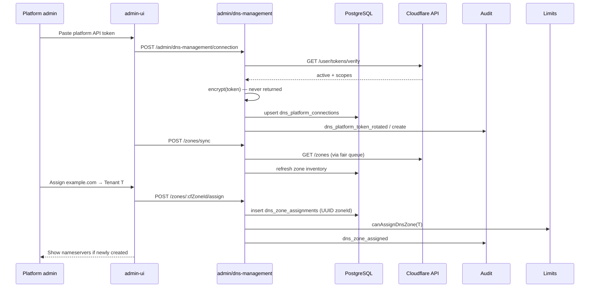
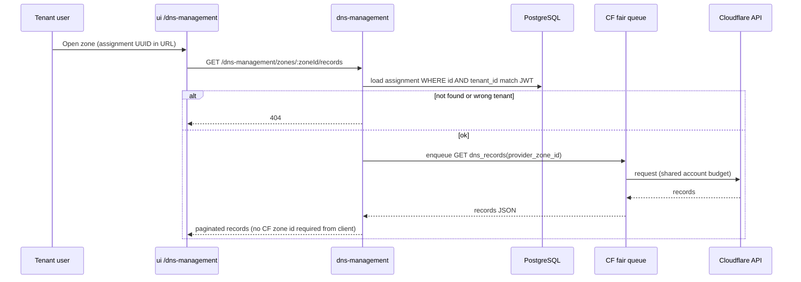
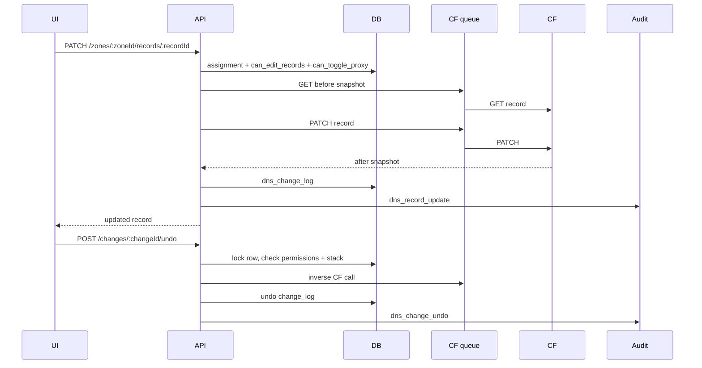

# DNS Management — Request flow

## Platform admin: configure connection & assign zone



## Tenant: list records (assigned zone only)



## Tenant: mutate + audit + undo



## BYO token (later phase)

```mermaid
sequenceDiagram
  participant Tenant as Tenant admin
  participant UI
  participant API
  participant DB
  participant CF

  Tenant->>UI: Connect own Cloudflare token
  UI->>API: POST /dns-management/connections
  API->>CF: verify token
  API->>DB: dns_tenant_connections + assignments per zone
  Note over API,DB: Same tenant APIs use assignment UUID; connection_id points to tenant token
  Tenant->>UI: Edit records
  UI->>API: PATCH .../records (BYO uses per-tenant rate bucket)
```

## ASCII overview

```
Platform path:
  admin-ui → /admin/dns-management/* → AdminAuthGuard
         → platform token (encrypted) → CF fair queue → api.cloudflare.com
         → dns_platform_connections + dns_zone_assignments

Tenant path:
  ui → /backend/dns-management/* → JwtAuthGuard + RolesGuard + @CurrentTenant()
         → resolve zoneAssignmentId → provider_zone_id (never from client)
         → check canEditRecords / canDeleteRecords / canToggleProxy
         → CF fair queue (shared) OR BYO per-tenant bucket
         → dns_change_logs + AuditLogsService

Billing:
  assign zone → LimitsService.canAssignDnsZone(tenantId) → plan dnsZoneLimit
```
