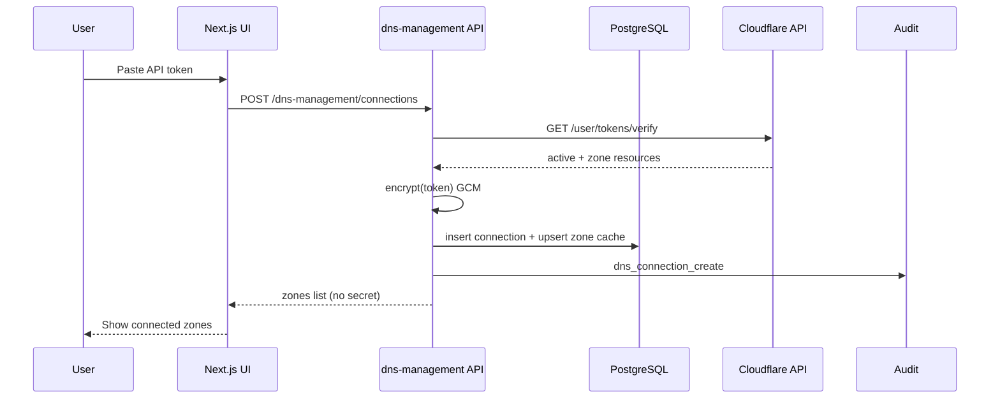
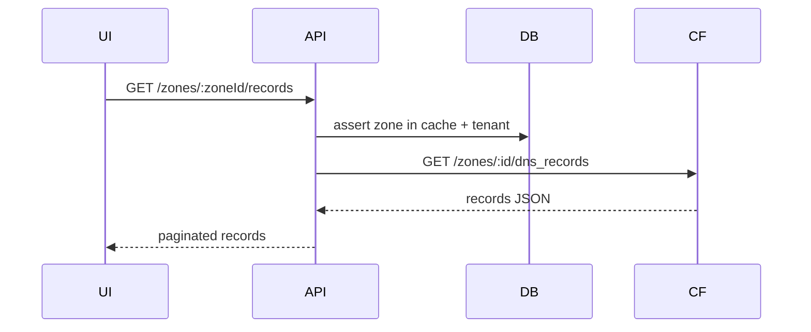
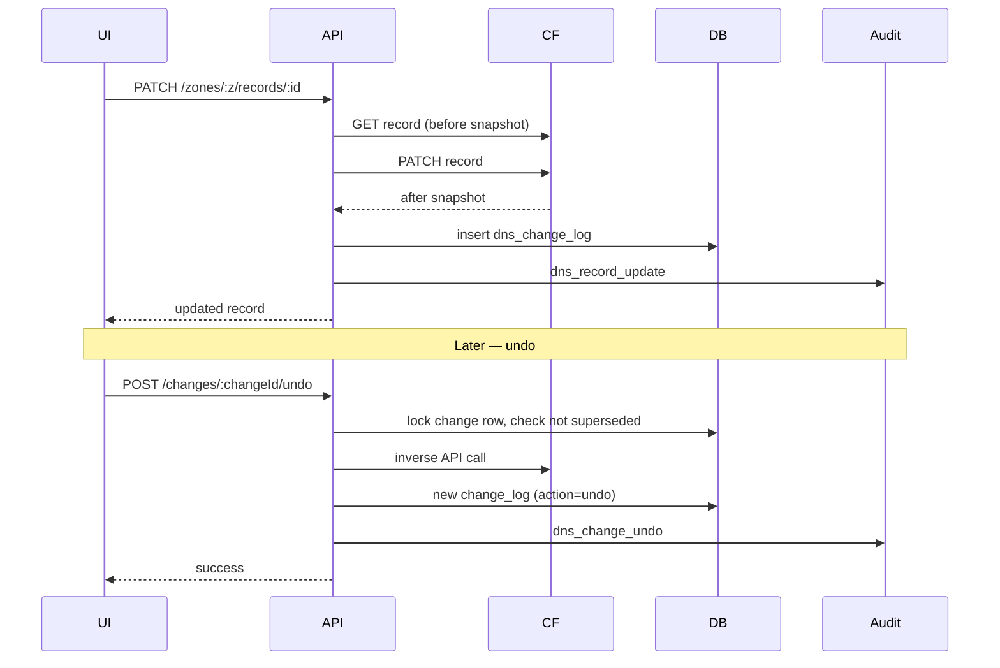

# DNS Management — Request flow

## Connect Cloudflare token



## List records (live read)



## Update record + audit + undo



## ASCII overview (single page)

```
User → UI (/backend/dns-management/*) → Nest Controller
         → RolesGuard + tenant_id scope
         → DnsManagementService
              ├─ decrypt token (memory-only, short-lived)
              ├─ CloudflareDnsProvider → api.cloudflare.com (fixed host)
              ├─ dns_zone_cache / dns_change_logs (Postgres)
              ├─ AuditLogsService (hash-chained audit_logs)
              └─ Redis rate limit (per tenant / connection)
```
