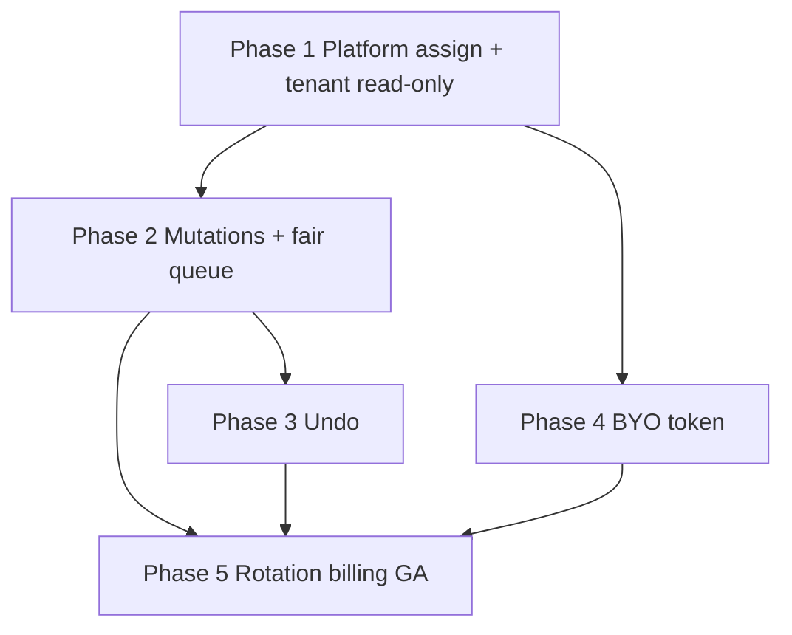

# DNS Management — Implementation plan

Phased, **PR-sized** delivery. Each phase merges independently. Sizes: **S / M / L** (relative effort, not calendar time).

**Design reference:** [DESIGN.md](./DESIGN.md) (rev 2 — **MSP-hosted zones primary**)  
**Codebase anchors:** `api/src/modules/admin/`, `api/src/modules/dns-management/`, `admin-ui/`, `ui/`, [`LimitsService`](../../../api/src/modules/limits/limits.service.ts)

---

## Phase 1 — Platform connection, zone import/assign, tenant read-only (shippable MVP)

**Size:** L  
**Goal:** Platform admin connects Flux Cloudflare account, assigns zones to tenants; tenant users browse assigned zones and records only.

### Scope

| Area | Work |
|------|------|
| **Brand** | `PRODUCT_MODULE_DNS_MANAGEMENT` in [`shared/product-brand.ts`](../../../shared/product-brand.ts); sync script. |
| **API — platform** | `admin/dns-management` controller (`AdminAuthGuard`); platform connection CRUD + verify; `POST zones/sync`, `POST zones` (create), `POST assign`, `unassign`, `PATCH permissions`. |
| **API — tenant** | `GET /dns-management/zones`, `GET .../records`; assignment UUID as `zoneId`; strict tenant resolution. |
| **Data** | Migrations: `dns_platform_connections`, `dns_zone_assignments` (permission flags included). |
| **Encryption** | `DNS_MANAGEMENT_ENCRYPTION_KEY` in [`encryption.config.ts`](../../../api/src/config/encryption.config.ts). |
| **Provider** | `CloudflareDnsProvider` + **skeleton fair queue** (global Redis bucket, serial CF calls acceptable in P1 with metrics hooks). |
| **Limits hook** | `canAssignDnsZone` + count assignments; wire to plan limits JSON (default high until billing PR). |
| **admin-ui** | DNS Platform section: connection page, zone inventory, assign/create zone + nameserver display. |
| **ui** | ModuleSwitcher entry; read-only zone list + record table; empty state when no assignments. |
| **Tests** | **Cross-tenant leakage integration tests** (required); mock CF. |

### Acceptance criteria

- [ ] Platform admin can verify and store platform token; token never in API responses or tenant UI.
- [ ] Admin can sync zones from Flux account, assign zone to tenant with permission flags, create zone and see nameservers.
- [ ] Tenant sees **only** assigned zones; records load via internal resolution (client never sends CF zone id).
- [ ] Cross-tenant access to another tenant’s `zoneId` returns **404**; CI test proves it.
- [ ] Assigning zone when at `dnsZoneLimit` fails with limit error.
- [ ] Swagger documents admin + tenant read routes.

### Suggested PR split

1. API + migrations + admin endpoints + leakage tests  
2. admin-ui connection + assign  
3. Tenant ui read-only + ModuleSwitcher  

---

## Phase 2 — Tenant record mutations + change log + shared queue hardening

**Size:** M  
**Goal:** Tenants edit DNS within assignment permissions; platform shares CF API budget fairly.

### Scope

- Tenant `POST/PATCH/DELETE` records with type allowlist; `confirmName` delete; proxy gated by `canToggleProxy`.
- `dns_change_logs` + audit enum extensions + `AuditLogsService.log`.
- **Fair queue v1:** weighted per-tenant scheduling, coalesced GETs, Redis cache for record lists (45–60s TTL).
- Global bucket ~1080 req / 5 min; metrics `dns_cf_queue_depth`, alerts on 429.
- UI: inline edit, add/delete modals, disabled controls when flags false.
- MSP context-switch metadata on mutations.

### Acceptance criteria

- [ ] Permission flags enforced server-side (403 with clear code if UI bypassed).
- [ ] Every mutation writes change log + audit entry.
- [ ] Load test (mock CF): two tenants cannot monopolize queue (fairness smoke test).
- [ ] CF 429 surfaces Retry-After to client.

---

## Phase 3 — Change history UI + undo

**Size:** M  
**Goal:** Undo from module history with stack rules.

### Scope

- `GET /changes`, `GET /changes/:id`, `POST /changes/:id/undo` (respect `canEditRecords` / delete undo rules).
- UI `/dns-management/history`; audit `dns_change_undo`.
- Admin optional: view tenant change history in admin-ui (read-only support view).

### Acceptance criteria

- [ ] Undo restores prior state when stack allows; 409 when newer change exists.
- [ ] Undone changes not re-undoable in UI.

---

## Phase 4 — BYO Cloudflare token (secondary model)

**Size:** M  
**Goal:** Tenants who keep their own CF account connect a token; same UX/API shape via assignments.

### Scope

- `dns_tenant_connections` migration + tenant `POST/GET/DELETE /dns-management/connections`.
- Verify on connect; create assignments with `provisioning_model: byo_token`.
- Per-tenant CF rate bucket (separate from platform queue).
- Tenant UI: Settings → optional BYO connection (platform-hosted tenants see no token UI).
- Audit actions for BYO connect/disconnect.

### Acceptance criteria

- [ ] BYO tenant manages records only on zones their token can access and that are linked.
- [ ] Platform token never exposed to BYO flow; two models coexist in one provider interface.
- [ ] Cross-tenant tests cover BYO assignments.

---

## Phase 5 — Token rotation, runbooks, billing GA, test hardening

**Size:** S–M  
**Goal:** Production readiness for MSP-hosted default.

### Scope

- Admin `connection/rotate`; revoke runbook [`docs/runbooks/dns-platform-token-compromise.md`](../../runbooks/dns-platform-token-compromise.md).
- Alerting rules: mutation anomaly, queue depth, connection `invalid`.
- Plan limits: `dnsZoneLimit` on subscription plans + usage widget hook.
- Contract tests + Playwright (admin assign → tenant edit → undo).
- Enable `dns-management` in [`tier-features.ts`](../../../ui/src/lib/tier-features.ts) for enterprise/MSP.
- API doc section in [`docs/D-api-spec.md`](../../D-api-spec.md).

### Acceptance criteria

- [ ] Rotation replaces ciphertext without unassigning zones (re-verify succeeds).
- [ ] Runbook reviewed by ops path in repo.
- [ ] CI includes leakage + contract suite on module touch.
- [ ] No open P0 items from updated threat model.

---

## Dependency graph

---

## Out of scope (all phases)

- Tenant-facing Cloudflare zone settings / SSL / page rules (MSP-only v1).
- Route 53, templates, BIND, DMARC publish, drift snapshots.
- Changes to dnsdist / policy-svc data plane.

---

## Open questions

1. **Single vs dual platform tokens:** one token for sync+mutate in P1, or separate read/write tokens in P5?  
2. **MSP self-serve assign:** can MSP tier assign zones without platform admin, or always via admin-ui in v1? (Design assumes platform admin / Flux ops in P1.)  
3. **Analyst role:** still read-only for mutations (recommended).
