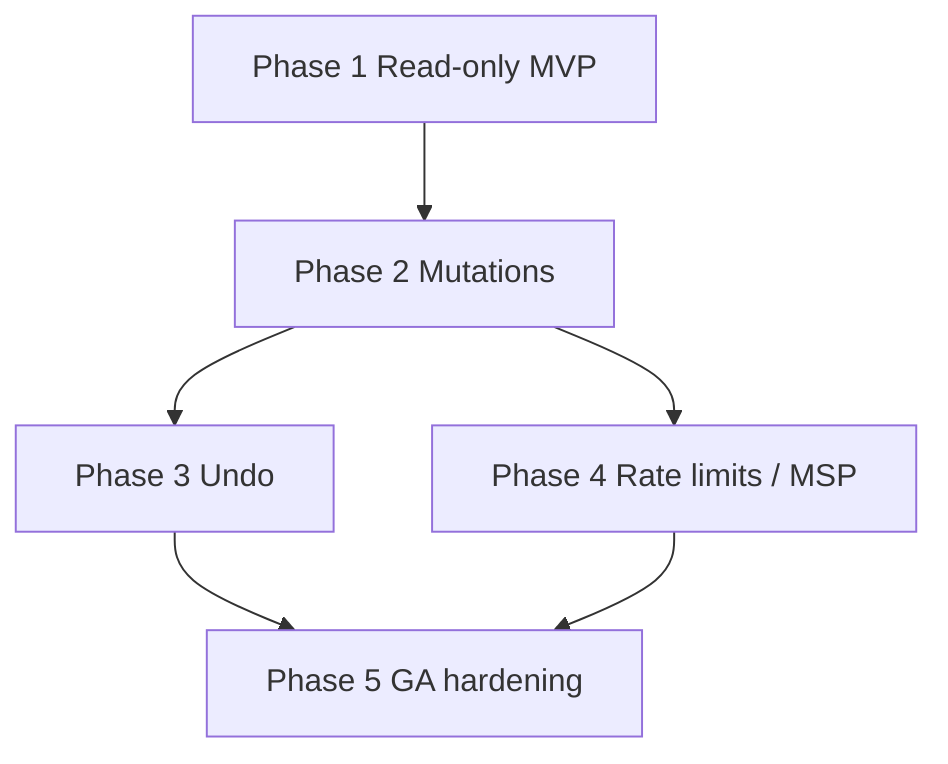

# DNS Management — Implementation plan

Phased, **PR-sized** delivery. Each phase is intended to merge independently. Estimates are **relative size** (S / M / L), not calendar time.

**Design reference:** [DESIGN.md](./DESIGN.md)  
**Codebase anchors:** `api/src/modules/*`, `ui/src/app/`, `shared/product-brand.ts`, `shared/flux-labs-tailwind-theme.js`

---

## Phase 1 — Connect + read-only zones and records (shippable MVP)

**Size:** L  
**Goal:** A tenant admin can connect Cloudflare and browse zones/records. No mutations yet.

### Scope

| Area | Work |
|------|------|
| **Shared brand** | Add `PRODUCT_MODULE_DNS_MANAGEMENT` to [`shared/product-brand.ts`](../../../shared/product-brand.ts); run `./scripts/sync-product-brand.sh`. |
| **API module skeleton** | `api/src/modules/dns-management/` — module, controller, service, DTOs, `CloudflareDnsProvider`, HTTP client with fixed base URL. |
| **Encryption** | Add `DNS_MANAGEMENT_ENCRYPTION_KEY` to [`api/src/config/encryption.config.ts`](../../../api/src/config/encryption.config.ts); token encrypt/decrypt mirroring [`SiemService`](../../../api/src/modules/siem/siem.service.ts). |
| **Migrations** | `dns_provider_connections`, `dns_zone_cache` entities + TypeORM migration under `api/src/database/migrations/`. |
| **Endpoints** | `POST/GET connections`, `POST verify`, `GET zones`, `GET zones/:id/records`; RBAC read vs admin on connect routes per design. |
| **Verify on connect** | Cloudflare `/user/tokens/verify`; persist `allowed_zone_ids`; sync zone cache. |
| **UI** | Module entry in [`ModuleSwitcher.tsx`](../../../ui/src/components/layout/ModuleSwitcher.tsx); routes `/dns-management`, `/dns-management/settings/connection`, zone detail read-only table; hooks in `ui/src/hooks/` or `ui/src/lib/api.ts` for new endpoints. |
| **Feature flag** | Optional `dns-management` in [`tier-features.ts`](../../../ui/src/lib/tier-features.ts) default off until GA. |

### Acceptance criteria

- [ ] Admin can connect a valid scoped token; UI lists only zones granted by the token.
- [ ] Invalid token returns a clear error; connection stays `invalid` or is not created.
- [ ] Read-only role can list zones and records but receives 403 on connect.
- [ ] Token never appears in API responses, browser storage, or application logs.
- [ ] Unit tests for encryption round-trip and provider client with mocked CF responses.
- [ ] Swagger tag `dns-management` documents connect + read endpoints.

### Suggested PR split (optional)

1. API + migration + provider mock tests  
2. UI connect + zone/record read views + ModuleSwitcher  

---

## Phase 2 — Record mutations + delete safety

**Size:** M  
**Goal:** Full v1 CRUD (except undo) with change logging and platform audit entries.

### Scope

- `POST/PATCH/DELETE` record endpoints with type validation (A/AAAA/CNAME/MX/TXT/SRV/CAA/NS).
- Proxy toggle via `PATCH` (`proxied` field).
- `DELETE` requires `{ confirmName }` matching FQDN.
- Create `dns_change_logs` migration + write on every successful mutation.
- Extend `AuditAction` / `AuditResourceType` enums in [`audit-log.entity.ts`](../../../api/src/modules/audit-logs/entities/audit-log.entity.ts) + migration.
- Call `AuditLogsService.log()` on each mutation.
- UI: inline edit, add record, delete modal with typed confirmation, proxy switch (admin+).
- Invalidate per-zone Redis cache key on mutation (if Phase 1 added optional cache).

### Acceptance criteria

- [ ] Admin can create, edit, delete, and toggle proxy; analyst/readonly cannot.
- [ ] Every mutation creates a `dns_change_logs` row with accurate `before_json` / `after_json`.
- [ ] Matching entries appear in tenant audit log (Settings → Audit).
- [ ] Delete without correct `confirmName` returns 400.
- [ ] Cloudflare validation errors surface as 400 with readable messages.
- [ ] Integration test covers create → update → delete with mocked CF.

---

## Phase 3 — Change history UI + undo

**Size:** M  
**Goal:** Complete v1 undo story from module change history.

### Scope

- `GET /dns-management/changes`, `GET /changes/:id`, `POST /changes/:id/undo`.
- Undo transaction with consistency check (record unchanged since original `after_json`).
- Link undo rows via `reverts_change_id` / `undone_by_change_id`.
- UI: `/dns-management/history` with filters and undo button + confirm dialog.
- Audit action `dns_change_undo`.

### Acceptance criteria

- [ ] Undo of last change restores prior DNS state in Cloudflare (verified in mock/integration test).
- [ ] Undo blocked with 409 if a newer change exists for the same record.
- [ ] Undone rows marked non-repeatable in UI.
- [ ] MSP user performing undo while context-switched logs client `tenant_id` and MSP metadata in `metadata`.

---

## Phase 4 — Rate limits, MSP hardening, connection lifecycle

**Size:** S  
**Goal:** Production safety and partner operations.

### Scope

- Apply [`@RateLimit()`](../../../api/src/modules/rate-limit/decorators/rate-limit.decorator.ts) on CF-backed routes; per-connection Redis budget respecting CF 429.
- `POST /zones/sync`, connection `DELETE`, re-verify flows polished; mark zones out of scope when token shrinks.
- Background job (optional `@Cron`) to re-verify stale connections &gt; 7 days — mark `invalid` on failure.
- Document MSP usage in [`docs/msp-migration-guide.md`](../../msp-migration-guide.md) cross-link.
- Metrics counters in [`MetricsService`](../../../api/src/modules/metrics/metrics.service.ts).

### Acceptance criteria

- [ ] CF 429 from upstream triggers backoff and 429 to client with `Retry-After`.
- [ ] Disconnect wipes or irreversibly marks token ciphertext revoked.
- [ ] Metrics visible in Prometheus scrape output for CF call counts.
- [ ] E2E test: MSP context switch → connect → edit → audit shows correct tenant.

---

## Phase 5 — Test hardening, docs, and GA toggle

**Size:** S  
**Goal:** Confidence to enable module for production tenants.

### Scope

- Contract test fixture suite for Cloudflare JSON (verify, zones, records CRUD).
- Playwright smoke: connect (mock), edit, history, undo.
- Update [`docs/D-api-spec.md`](../../D-api-spec.md) section for DNS Management (or add `docs/modules/dns-management/API.md` and link from D-api-spec).
- Enable `dns-management` tier feature for enterprise/MSP tiers.
- Runbook snippet in `docs/runbooks/` for “Cloudflare token invalid” support steps.

### Acceptance criteria

- [ ] CI runs dns-management unit + integration tests on every PR touching module.
- [ ] Playwright job passes in `ui` pipeline (or documented manual gate if not yet in CI).
- [ ] Product docs list required Cloudflare token permissions.
- [ ] No open P0 security items from design threat table.

---

## Dependency graph

---

## Out of scope for all phases (explicit)

- Route 53 / DNSimple providers
- Templates, BIND import/export, DMARC publish, drift snapshots
- Hosting zones under Flux Cloudflare account
- Changes to `policy-svc`, dnsdist, or Unbound data plane

---

## Open questions (resolve before Phase 2 merge)

1. **Analyst role:** read-only for mutations (recommended) or allow edits? Design assumes read-only.
2. **Multiple connections per tenant:** v1 design assumes one active Cloudflare connection; confirm with product.
3. **API path versioning:** Nest controllers today use unprefixed paths (`/lists`); confirm gateway mapping if public docs must stay `/api/v1/...` per [`docs/D-api-spec.md`](../../D-api-spec.md).
